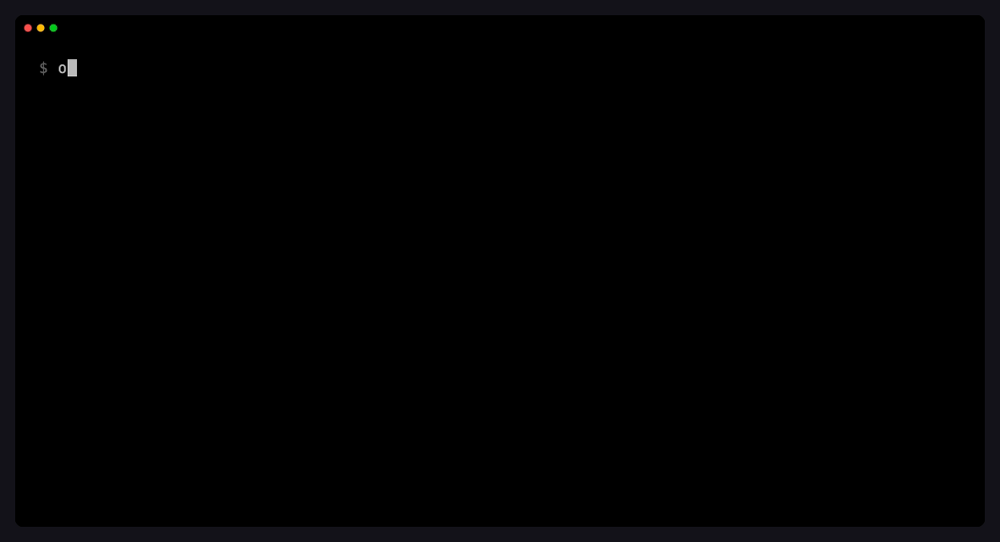

<h1 align="center">opensume</h1>

<p align="center">
  Images and video from your terminal, on the <a href="https://open.sume.com">Sume Open API</a>.
</p>

<p align="center">
  <a href="https://github.com/sumelabs/opensume-cli/actions/workflows/ci.yml"></a>
  <a href="https://github.com/sumelabs/opensume-cli/releases"></a>
  <a href="LICENSE"></a>
  
</p>

<p align="center">
  
  <br><sub>A real session against the API, played at 1.5×.</sub>
</p>

`opensume` runs any model on [open.sume.com](https://open.sume.com) from one command. It covers image, video, lip-sync and captions. It shows the price in dollars before you spend, submits the job, waits for it, and saves the file next to you. The same command works for a person at a terminal and for a script or an AI agent: add `--json` and every command prints one JSON document.

- **Prompt to file in one command.** `opensume run <model> "<prompt>"` submits, polls and downloads.
- **Every open.sume.com model behind one key.** Images, video, lip-sync and captions, with prices from `opensume models`.
- **Know the price first.** `opensume estimate` is free and needs no key. `--max-usd` refuses anything over budget.
- **Local files just work.** Pass `--image ./photo.png`; it is uploaded for you.
- **Safe to retry.** Submits carry an idempotency key, the CLI's own retries reuse it, and an error after a submit names the key or the job, so a retry never pays twice.
- **Made for scripts and agents.** `--json` everywhere, documented exit codes, a machine-readable command list, and an [agent skill](skills/opensume/SKILL.md).
- **One self-contained binary.** No runtime to install, no dependencies, no telemetry, no background update checks.

> [!NOTE]
> open.sume.com and its API are in preview. The CLI talks to the API at `https://api.dev.sume.com`; the [API docs](https://open.sume.com/docs) are on open.sume.com. Set `SUME_API_BASE_URL` to point the CLI elsewhere.

## Contents

- [Install](#install)
- [Quick start](#quick-start)
- [Commands](#commands)
- [Prices and spending](#prices-and-spending)
- [Scripts and agents](#scripts-and-agents)
- [Configuration](#configuration)
- [How it works](#how-it-works)
- [Troubleshooting](#troubleshooting)
- [Uninstall](#uninstall)
- [Contributing](#contributing)

## Install

**macOS and Linux**

```sh
curl -fsSL https://raw.githubusercontent.com/sumelabs/opensume-cli/main/install.sh | sh
```

**Windows (PowerShell)**

```powershell
irm https://raw.githubusercontent.com/sumelabs/opensume-cli/main/install.ps1 | iex
```

Both scripts download the binary for your platform from the [latest release](https://github.com/sumelabs/opensume-cli/releases/latest), check it against the release's SHA-256 checksums, and put it on your `PATH` (`~/.opensume/bin`, or `%LOCALAPPDATA%\opensume\bin` on Windows). Builds exist for macOS (Apple silicon and Intel), Linux (x64 and arm64, glibc and musl/Alpine) and Windows x64. Set `OPENSUME_VERSION=0.1.0` to pin a version, `OPENSUME_INSTALL_DIR` to choose the folder, or `OPENSUME_NO_MODIFY_PATH=1` to leave your `PATH` alone.

**With Node.js 22 or newer**

```sh
npm install -g https://github.com/sumelabs/opensume-cli/releases/latest/download/opensume.tgz
```

**From source**

```sh
git clone https://github.com/sumelabs/opensume-cli.git && cd opensume-cli
npm ci && npm run build && npm link
```

Check it with `opensume --version`.

## Quick start

**1. Get a key.** Sign in at [open.sume.com](https://open.sume.com), open **API keys**, and create one. Then save it:

```sh
opensume auth login        # paste the key; it is checked, then stored for your user only
```

Or export it for the current shell instead: `export SUME_API_KEY="sume_live_..."`.

**2. Make an image.** This one costs $0.0077:

```console
$ opensume run gpt-image-2 "a ceramic cup on a wooden table, morning light" -q low -o cup.png
Job job_7558248a-3a25-4b2a-9f6a-832bdc23b846
✓ gpt-image-2 completed in 15s · $0.0077
  cup.png  934 KB · image/png
```

**3. Turn it into a video.** The local file is uploaded first. This one costs $0.05:

```console
$ opensume run grok-imagine-video-1.5 "slow push in, steam rising" --image cup.png -d 4 -r 480p
↑ cup.png 934 KB uploaded
Job job_90f64f18-cd22-4ab3-8fc3-2a241a8678a5
✓ grok-imagine-video-1.5 completed in 26s · $0.0500
  grok-imagine-video-1.5-90f64f18.mp4  957 KB · video/mp4
```

<table>
  <tr>
    <td align="center"><br><sub><code>cup.png</code> · gpt-image-2</sub></td>
    <td align="center"><br><sub><code>grok-imagine-video-1.5-90f64f18.mp4</code></sub></td>
  </tr>
</table>

**4. Explore.** `opensume models` lists every model with its starting price, and `opensume models <id>` shows what a model takes:

```console
$ opensume models seedance-2-mini
seedance-2-mini — Seedance 2.0 Mini (ByteDance)
Generates video from text, an image, references · 480p to 720p · 4–15 s · native audio

Kind           video
Modes          text-to-video, image-to-video, reference-to-video
Price          from $0.0879/s
               480p  $0.0879/s
               720p  $0.1890/s
Takes          text to video, image to video, end frame, reference images, reference videos,
               reference audio, audio
Resolutions    480p, 720p
Duration       4–15 s
Aspect ratios  auto, adaptive, 21:9, 16:9, 4:3, 1:1, 3:4, 9:16

Try it
  $ opensume run seedance-2-mini "a paper boat drifting down a rain gutter" -d 4 -r 480p
```

## Commands

| Command | What it does |
|---|---|
| [`run`](#run) | Generate an image or a video and save it |
| [`estimate`](#estimate) | Price a request in dollars, free, with no key |
| [`upload`](#upload) | Upload local files and print their media URLs |
| [`models`](#models) | List models and prices, or show one |
| [`jobs`](#jobs) | List, wait for, inspect and cancel jobs |
| [`auth`](#auth) | Save, check or forget your key |
| `completion` | Shell completion for bash, zsh and fish |
| `update` | Update a standalone install to the latest release |
| `version` | Print the version |

Every command has `--help`. Global flags work anywhere: `--json`, `--quiet`, `--verbose` (each API call with its request id), `--no-color`, `--api-key` and `--base-url`.

### run

```sh
opensume run <model> [prompt] [flags]
```

`run` picks the right endpoint for the model, uploads any local files, submits with an idempotency key, waits, and saves the result. Without `-o`, files land in the current directory as `<model>-<job>.<ext>` and never overwrite anything.

```sh
# Edit an image with a reference
opensume run gpt-image-2 "the same cup, at night by candlelight" --image cup.png -q medium

# Video from text, with a budget
opensume run seedance-2-mini "a paper boat drifting down a rain gutter" -d 4 -r 480p --max-usd 0.50

# Lip-sync a clip to speech
opensume run veed-lipsync --video talk.mp4 --audio line.wav -d 6

# Burn captions into a clip (fields without a flag go through --set)
opensume run veed-subtitles --video clip.mp4 -d 12 --set captions.style=glass

# Submit now, collect later
opensume run kling-3 "a red kite over a beach" -d 5 --no-wait
opensume jobs wait job_...
```

| Flags | |
|---|---|
| **Inputs** | `-p, --prompt` · `-i, --image` (repeatable) · `--end-image` · `--video` · `--audio` · `--ref-image`, `--ref-video`, `--ref-audio` (repeatable) · `--mask`. Each takes a public https URL or a local file. |
| **Settings** | `-a, --aspect-ratio` · `-r, --resolution` · `-d, --duration` · `-q, --quality` · `-n, --num-images` · `--format` · `--size` · `--background` · `--[no-]generate-audio` · `--set key=value` for any other field (JSON values, `a.b` nesting, `key[]=` to append) · `--input body.json` (or `-` for stdin) |
| **Output** | `-o, --output <file or dir/>` · `--no-download` (print URLs) · `--all-files` (also save intermediate files, like a video's poster frame) · `--timeout 20m` · `--open` |
| **Submit** | `--max-usd <dollars>` · `--dry-run` (print the request and price) · `--no-wait` · `--webhook <url>` · `--idempotency-key <key>` |

A flag that a model's endpoint does not take is refused before anything is sent: `--duration` on an image model, for example. Ctrl-C stops waiting, not the job: the CLI prints the job id, and `opensume jobs wait <id>` picks it up later.

### estimate

```console
$ opensume estimate seedance-2-mini "a paper boat" -d 4 -r 480p
$0.3516  seedance-2-mini · 4s · 480p · 40.176 × 1000 video tokens
```

`estimate` takes the same input flags as `run` and submits nothing. Local files are not uploaded to price a request. If the API prices something other than what you asked for, `estimate` says so. A 99-second request on a 15-second model, for example, is priced as 15 seconds.

### upload

```sh
opensume upload photo.png clip.mp4      # prints one media URL per file
```

### models

```sh
opensume models                         # every model, with its starting price
opensume models --kind video            # image, video, lipsync or captions
opensume models --company google
opensume models seedance                # filter by any word
opensume models veed-subtitles          # one model: inputs, limits, prices, notes
```

### jobs

```sh
opensume jobs list [--status processing] [--limit 50]
opensume jobs get <id>         # input, timing, error, files
opensume jobs status <id>      # one status read
opensume jobs wait <id> [-o dir/]   # wait for it, then save its files
opensume jobs events <id>      # the job's timeline, including why it failed
opensume jobs cancel <id>      # only before generation starts; refunded
```

### auth

```sh
opensume auth login                                  # prompts, hidden
printenv SUME_API_KEY | opensume auth login --with-key   # from stdin
opensume auth status                                 # which key and host, and whether the key works
opensume auth logout                                 # forget the saved key
```

## Prices and spending

open.sume.com keys pay in US dollars from your open.sume.com balance; top up under **Billing**.

- **Before you submit:** `opensume estimate` and `opensume run --dry-run` show the price for free. The estimate is what a completed job is charged.
- **When you submit:** the price is reserved. With `--max-usd`, the CLI checks the estimate first and submits nothing if the price is higher (exit code 7).
- **When the job ends:** a completed job is charged; a failed or canceled job is refunded.
- **Retries never double-charge:** every submit carries an `Idempotency-Key`, and a retried submit returns the original job. If the CLI gives up on a submit, the error prints the key (`idempotency_key` in `--json`); rerun with `--idempotency-key <key>` to adopt the job rather than create another.

## Scripts and agents

**`--json`** prints exactly one JSON document on stdout for every command, errors included, and nothing on stderr. Abridged:

```console
$ opensume run gpt-image-2 "a red kite over a beach, flat illustration" -q low -o kite.png --max-usd 0.02 --json
{
  "job": { "id": "job_d45000cc-9bc7-4631-8feb-18e596a6da3d", "model": "gpt-image-2", "status": "completed" },
  "usd": "0.0077",
  "elapsed_ms": 15093,
  "artifacts": [
    {
      "id": "artf_oaWANFBUVhkFz_urjAHjBw21wn_qb_Ya",
      "type": "image",
      "url": "https://media.sume.com/artifacts/artf_oaWANFBUVhkFz_urjAHjBw21wn_qb_Ya/images.png",
      "content_type": "image/png",
      "path": "/home/you/kite.png",
      "bytes": 618337
    }
  ],
  "idempotency_key": "05614b0e-04ac-4c56-84d6-6d303e8744d4"
}
```

Without `--json`, results go to stdout and everything else (progress, notes, errors) to stderr, so `opensume run … | xargs open` gets just the file paths.

**Exit codes** are stable:

| Code | Meaning |
|---|---|
| `0` | Success |
| `1` | Unexpected error, network failure, server error |
| `2` | Bad command line: unknown flag, missing argument |
| `3` | No key, wrong or revoked key, or a route the key may not call |
| `4` | The API refused the request: invalid input, unknown model or job |
| `5` | The job failed or was canceled (`opensume jobs events <id>` says why) |
| `6` | `--timeout` passed while the job was still running |
| `7` | Balance too low, or the price is over `--max-usd` |
| `8` | Rate limit or concurrency cap; retry later |
| `130` | Interrupted with Ctrl-C (the job keeps running) |

**The whole command tree as JSON:** `opensume --help --json`. It is generated from the same definitions as `--help`, so it never drifts.

**Agent skill.** [`skills/opensume/SKILL.md`](skills/opensume/SKILL.md) teaches coding agents (Claude Code and others that read skills) to pick a model, check the price, cap the spend and handle long jobs. Copy it into your agent's skills folder:

```sh
mkdir -p ~/.claude/skills/opensume
curl -fsSL https://raw.githubusercontent.com/sumelabs/opensume-cli/main/skills/opensume/SKILL.md -o ~/.claude/skills/opensume/SKILL.md
```

## Configuration

| Setting | Flag | Environment | Saved in config |
|---|---|---|---|
| API key | `--api-key` | `SUME_API_KEY` | `opensume auth login` |
| API host | `--base-url` | `SUME_API_BASE_URL` | `opensume auth login --base-url …` |

A flag beats the environment, which beats the config file. The config file is `~/.config/opensume/config.json` (`$XDG_CONFIG_HOME` is honored, `%APPDATA%\opensume` on Windows, or `$OPENSUME_CONFIG_DIR`). It is created readable by your user only. The key in it is not encrypted, so treat it like an SSH key, or use `SUME_API_KEY` instead.

Color follows the terminal; `NO_COLOR=1` or `--no-color` turns it off and `FORCE_COLOR=1` turns it on. Completion caches model ids for a day under `~/.cache/opensume`.

**Shell completion** (commands, flags and model ids):

```sh
eval "$(opensume completion bash)"     # in ~/.bashrc
eval "$(opensume completion zsh)"      # in ~/.zshrc
opensume completion fish > ~/.config/fish/completions/opensume.fish
```

## How it works

```text
opensume run  ──▶  POST /v1/{image,video}-router/generate   202 + job id, with an Idempotency-Key
              ──▶  GET  /v1/jobs/{id}/status                until terminal
              ──▶  GET  /v1/jobs/{id}/result                artifacts on media.sume.com
              ──▶  download each file                        through a .part file, then renamed
```

- **Picking the endpoint.** The model's `kind` in the open catalog decides it. Image models go to the image router; video, lip-sync and captions go to the video router.
- **Polling.** The CLI follows the API's `next_poll_after_seconds`, capped at 5 s for the first minute of waiting, 10 s up to ten minutes, and 15 s after that, so a job that finishes early is noticed early. Transient errors (network, 429, 5xx) are retried and do not end the wait.
- **Retries.** Reads, and submits that carry an idempotency key, are retried with backoff, honoring `retry-after`.
- **Files.** By default the CLI saves a job's final outputs. Intermediate files, like a video's poster frame, are listed in `--json` and saved only with `--all-files`.

## Troubleshooting

| You see | What to do |
|---|---|
| `No API key` (exit 3) | `opensume auth login`, or export `SUME_API_KEY`. |
| `Missing or invalid API key` (exit 3) | The key is wrong or revoked. Create a new one at open.sume.com → API keys. |
| `The API key contains spaces, line breaks…` (exit 3) | The key was pasted with extra characters. Copy it again. |
| `open_key_route_not_allowed` (exit 3) | open.sume.com keys call images, video, jobs and prices only. |
| `Balance too low` (exit 7) | Top up at open.sume.com → Billing. The error shows the price and your balance. |
| `concurrency_limit_reached` (exit 8) | Your workspace has as many jobs in flight as it may. Wait for one to finish. |
| `Stopped waiting after …` (exit 6) | The job is still running. `opensume jobs wait <id>` collects it later; do not resubmit. |
| Anything else | Re-run with `--verbose` and quote the request id (`req_…`) when you ask for help. |

## Uninstall

```sh
rm -rf ~/.opensume ~/.config/opensume ~/.cache/opensume   # binary, saved key, completion cache
```

Then remove the two lines the installer added to your shell profile (`# opensume` and the `export PATH=…` under it), or `~/.config/fish/conf.d/opensume.fish` for fish. On Windows, delete `%LOCALAPPDATA%\opensume` and `%APPDATA%\opensume`, and remove the folder from your user `PATH`. If you installed with npm: `npm uninstall -g opensume`.

## Contributing

Bug reports, ideas and pull requests are welcome. [CONTRIBUTING.md](CONTRIBUTING.md) covers setup, tests and releases. Security problems go through [SECURITY.md](SECURITY.md), not public issues. Everyone taking part follows the [code of conduct](CODE_OF_CONDUCT.md).

## License

[MIT](LICENSE) © 2026 Sume Labs
